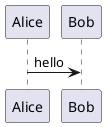

# PlantUML Live Editor

Минималистичный портативный редактор PlantUML: код слева, живой просмотр справа. Один JAR, тёмный интерфейс, локальный рендер без сервера.

**Релиз 1.0.1 · Java 17+ · Windows / Linux / macOS**

## Запуск

Скачайте `plantuml-live-editor.jar` из раздела **Releases** и запустите:

```sh
java -jar plantuml-live-editor.jar
```

Можно сразу передать файл:

```sh
java -jar plantuml-live-editor.jar "path/to/diagram.puml"
```

Maven и интернет для запуска готового JAR не нужны. Java с поддержкой рабочего стола должна быть установлена отдельно.

На Windows для двойного щелчка нужна ассоциация вида `"путь\к\javaw.exe" -jar "%1" %*`. Простого выбора `java.exe` через «Открыть с помощью» недостаточно. Системные ассоциации программа сама не меняет.

## Возможности

- Редактор с номерами строк, подсветкой PlantUML, автоотступом, поиском/заменой и undo/redo.
- Живой просмотр через 350 мс после изменения текста; рендер в фоне, устаревшие результаты отбрасываются.
- Масштабирование, вписывание в окно и просмотр 1:1.
- Копирование изображения в буфер.
- Одна кнопка «Сохранить изображение»; PNG/SVG выбирается в файловом диалоге.
- Открытие и сохранение `.puml` в UTF-8.
- Диагностика PlantUML с выделением строки ошибки.
- Русский интерфейс при русской системной локали, английский — при остальных, включая файловые диалоги.
- Нет переключателя языка, сохраняемых конфигов, сервера и телеметрии.

Новый документ содержит:



Вставка работает обычным Ctrl+V / Cmd+V и не изменяет текст. Markdown-ограждения автоматически не удаляются.

При ошибке отображается сообщение; остаётся последняя успешная диаграмма с единственным индикатором предыдущей версии. Копирование и сохранение картинки отключены до успешного рендера текущего кода. Автоисправления исходника нет.

## Клавиши

На macOS вместо Ctrl используется Cmd.

| Действие | Клавиши |
| --- | --- |
| Новый документ | Ctrl+N |
| Открыть | Ctrl+O |
| Сохранить | Ctrl+S |
| Сохранить как | Ctrl+Shift+S |
| Найти / заменить | Ctrl+F / Ctrl+H |
| Обновить просмотр | Ctrl+R |
| Закрыть поиск | Esc |
| Масштаб просмотра | Ctrl/Cmd + колесо |

## Сборка Maven

```sh
mvn clean package
java -jar target/plantuml-live-editor.jar
```

Тесты выполняются при `package`; отдельно: `mvn test`. Для первой сборки требуется доступ к Maven Central. Maven Assembly собирает runnable fat JAR непосредственно из классов и библиотек.

Стек: Java 17, Swing, FlatLaf 3.7.2, RSyntaxTextArea 3.6.0, PlantUML 1.2026.9. JUnit 6.0.3 используется только для тестов.

## Автономность и ограничения

PlantUML встроен в JAR. На Windows он может использовать свою встроенную минимальную сборку Graphviz; она распаковывается во временную папку и запускается локально. На других системах используется найденный Graphviz. Если исполняемого файла нет, редактор задаёт Smetana как конфигурацию по умолчанию, не изменяя исходник.

Принудительная Smetana:

```sh
java -Dpuml.smetana=true -jar plantuml-live-editor.jar
```

Smetana поддерживает не все особенности Graphviz и может давать другую раскладку. Найденный, но неисправный Graphviz вернёт ошибку. Явная настройка движка в диаграмме может переопределять конфигурацию по умолчанию.

Для автономного рендера включён профиль PlantUML `SANDBOX`: внешние файлы, сетевые `!includeurl` и внешние изображения не поддерживаются. Оформление самой диаграммы задаётся её кодом; тема интерфейса его не переписывает.

Один открытый документ, первая диаграмма/страница. Файл — до 2 МБ, рендеримый исходник — до 500 000 символов, сторона PNG ограничена 4096. Масштаб просмотра не меняет экспорт.

При некоторых некорректных группах PlantUML 1.2026.9 сам печатает внутренний стек в консоль. Редактор сообщает об ошибке, не экспортирует невалидный результат и ждёт изменения кода.

Автоматические проверки выполнены на Windows. Графический интерфейс и буфер обмена на Linux/macOS требуют отдельного прогона. См. [VALIDATION.md](VALIDATION.md).

## Лицензии

Редактор: **GPL-3.0-or-later**, полный текст — [LICENSE](LICENSE).

Лицензии зависимостей и встроенных компонентов: [THIRD-PARTY.md](THIRD-PARTY.md) и [licenses/](licenses/). Копии также находятся внутри JAR в `META-INF/licenses/`. Исходники доступны в этом репозитории; точные ссылки на исходники зависимостей приведены в THIRD-PARTY.md.

## English

A portable, offline PlantUML editor with a dark Swing UI, line numbers and syntax highlighting, debounced background preview, clipboard image copy, and PNG/SVG export. Requires Java 17+. Run `java -jar plantuml-live-editor.jar`; build with `mvn clean package`.

UI language follows the system locale: Russian for `ru`, English otherwise. No saved application settings. Invalid code is reported, never automatically repaired. Third-party notices and source links are included in the repository and in the JAR.


